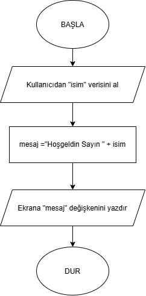

# kod_asistanim

Proje Yazarı: HÇ

# Projenin Adı: Kod-Asistan v0.1

## Projenin Amacı: Kullanıcılara günlük işlerinde (hesaplama, selamlama vb.) yardımcı olacak bir dijital asistan tasarlamak

## Projenin Hedefleri
Bu asistanın ilerleyen zamanlarda kazanacağı özellikler şunlardır:
* **v1.0:** Akıllı Menü entegrasyonu
* **v2.0:** Veri saklama ve geçmişi hatırda tutma özellikleri
* **v3.0:** Gelişmiş doğal dil işleme yetenekleri

## Projenin Kapsamı ve Kritik Eşik Mantığı
Proje kapsamında kullanıcı girdilerini değerlendiren ve belirli sınırları kontrol eden **Kritik Eşik** sözde kod mantığı metinsel olarak aşağıda yer almaktadır:

> **KRİTİK EŞİK Sözde Kod Mantığı:**
> 1. BAŞLA
> 2. Kullanıcıdan bir değer/girdi al (DEĞER)
> 3. Kritik eşik sınırını belirle (ESIK = 50)
> 4. EĞER DEĞER > ESIK ise:
>    * "Kritik eşik aşıldı! Güvenli sınırdesiniz." mesajı yazdır.
>    * Uyarı sistemini aktif et.
> 5. DEĞİLSE:
>    * "Normal seviyedesiniz, tehlike yok." mesajı yazdır.
> 6. BİTİR

## Kaynakça
Bu projenin tasarımında, algoritma yapısının kurgulanmasında ve dokümantasyon standartlarında aşağıdaki kaynaklardan yararlanılmıştır:

1. **Programlama Temelleri** - *Milli Eğitim Bakanlığı Yayınları 10942
2. **Ahilik Kültürü ve Meslek Etiği İlkeleri** - *Yazılım Etiği ve Açık Kaynak Lisanslama Standartları Reference Guide*.
3. **GitHub Documentation** - *About READMEs and Repository Documentation*, [https://docs.github.com/](https://docs.github.com/).

